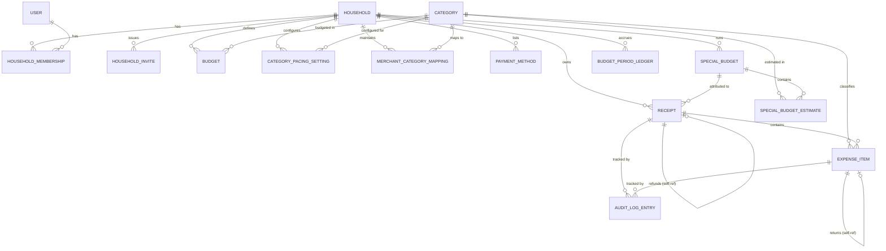

# Atomize — Data Model (v1)

Derived from [SPEC.md](SPEC.md). Relational model (works for Postgres or similar); adapt types as needed for your eventual stack.

## Entity Overview



---

## Household & Access

### `household`
| Field | Type | Notes |
|---|---|---|
| id | uuid (PK) | |
| name | text | e.g. "The Does" |
| home_timezone | text (IANA tz) | drives budget/pacing day & month boundaries (§10) |
| currency | text | fixed `"USD"` for v1 (§13 of SPEC) |
| created_at | timestamp | |

### `user`
| Field | Type | Notes |
|---|---|---|
| id | uuid (PK) | |
| email | text, unique | |
| name | text | |
| created_at | timestamp | |

### `household_membership`
| Field | Type | Notes |
|---|---|---|
| id | uuid (PK) | |
| household_id | FK → household | |
| user_id | FK → user | |
| role | enum: `super_user`, `contributor` | creator of household is auto `super_user` |
| joined_at | timestamp | |

Unique constraint: `(household_id, user_id)`.

### `household_invite`
| Field | Type | Notes |
|---|---|---|
| id | uuid (PK) | |
| household_id | FK → household | |
| code | text, unique | shareable code/link token (§2) |
| created_by_user_id | FK → user | must be a super_user |
| revoked_at | timestamp, nullable | super_user can revoke |
| created_at | timestamp | |

No per-invite expiration or per-invitee targeting specified — code is valid until revoked. Revisit if abuse becomes a concern.

---

## Categories & Budgets

### `category`
| Field | Type | Notes |
|---|---|---|
| id | uuid (PK) | |
| name | text | one fixed, global, canonical list (§4) — not per-household |
| sort_order | int | |
| is_active | boolean | for future deprecation without deleting history |

Note: custom/per-household categories are explicitly deferred (§21); this table has no `household_id`.

### `budget`
| Field | Type | Notes |
|---|---|---|
| id | uuid (PK) | |
| household_id | FK → household | |
| category_id | FK → category | |
| year_month | date (first-of-month) | the month this budget applies to |
| amount | numeric(12,2) | |
| notes | text, nullable | |
| created_at / updated_at | timestamp | |

Unique constraint: `(household_id, category_id, year_month)`. Each month's row is independent — no carryover logic lives here (§7); see `budget_period_ledger` below.

### `category_pacing_setting`
| Field | Type | Notes |
|---|---|---|
| id | uuid (PK) | |
| household_id | FK → household | |
| category_id | FK → category | |
| show_pacing | boolean | defaults true for variable categories, false for fixed/lump-sum (§13) |

Unique constraint: `(household_id, category_id)`.

### `budget_period_ledger`
Tracks the carryover-into-savings mechanic (§7): unspent budget doesn't roll into next month's `budget.amount`, but it does accumulate into a separate household total.

| Field | Type | Notes |
|---|---|---|
| id | uuid (PK) | |
| household_id | FK → household | |
| category_id | FK → category | |
| year_month | date | |
| budgeted_amount | numeric(12,2) | snapshot of `budget.amount` for that month |
| actual_spent | numeric(12,2) | computed from `expense_item` totals (incl. allocated tax) for that category/month, excluding special-budget-attributed items (§14) and treating returns as if they never happened (§12) |
| unspent_amount | numeric(12,2) | `budgeted_amount - actual_spent`, can be negative (overspend) |

Rows are computed/finalized at month close (batch job), one per household/category/month. The household's running "saved" total (§7) is `SUM(unspent_amount)` across all rows — a view/aggregate, not a separately maintained running counter, so it never drifts from the underlying ledger.

---

## Merchant Mapping

### `merchant_category_mapping`
| Field | Type | Notes |
|---|---|---|
| id | uuid (PK) | |
| household_id | FK → household | household-level, not global (§9) |
| merchant_normalized_name | text | output of AI merchant normalization |
| category_id | FK → category | default category for total-only receipts from this merchant |
| updated_by_user_id | FK → user | any household member may correct |
| updated_at | timestamp | |

Unique constraint: `(household_id, merchant_normalized_name)`. Corrections are **forward-only** (§9) — updating this row has no retroactive effect on existing receipts; it only changes the default applied to future total-only receipts from that merchant.

---

## Payment Methods

### `payment_method`
| Field | Type | Notes |
|---|---|---|
| id | uuid (PK) | |
| household_id | FK → household | |
| label | text | free-form, e.g. "MASTERCARD 1234", "Cash", "Venmo" |
| created_at | timestamp | |

Not used for balance tracking — purely a label referenced by `receipt.payment_method_label` (denormalized text is also acceptable if you don't need a dedicated table; kept here for clean filtering/search per §15).

---

## Special Budgets

### `special_budget`
| Field | Type | Notes |
|---|---|---|
| id | uuid (PK) | |
| household_id | FK → household | |
| name | text | e.g. "Ireland Summer 2026" |
| start_date | date | |
| end_date | date | |
| pacing_enabled_default | boolean | (§14) |
| created_at | timestamp | |

### `special_budget_estimate`
| Field | Type | Notes |
|---|---|---|
| id | uuid (PK) | |
| special_budget_id | FK → special_budget | |
| category_id | FK → category | |
| estimate_min | numeric(12,2) | |
| estimate_max | numeric(12,2) | ranges allowed (§10 of SPEC) |

Any receipt with `receipt.special_budget_id` set is excluded from that category's regular monthly budget math (§14) — enforced at query time in whatever computes `actual_spent` for `budget_period_ledger`.

---

## Receipts & Items

### `receipt`
| Field | Type | Notes |
|---|---|---|
| id | uuid (PK) | |
| household_id | FK → household | |
| merchant_name | text | as captured |
| merchant_normalized_name | text | AI-normalized, used for dedup & mapping lookups |
| transaction_datetime_local | timestamptz | the receipt's own local time, with its own offset (§10) |
| transaction_timezone | text (IANA tz) | timezone at point of purchase |
| transaction_date_home | date | derived: which home-timezone calendar day/month this counts toward (§10) — stored denormalized for fast budget-period queries |
| location_city | text, nullable | |
| location_country | text, nullable | |
| location_address | text, nullable | |
| original_currency | text | ISO code |
| exchange_rate | numeric(18,8), nullable | to USD, stored at transaction time (§17) |
| total_amount | numeric(12,2) | in original currency; USD-equivalent derivable via exchange_rate |
| tax_total | numeric(12,2), nullable | explicit tax total if present |
| payment_method_label | text | denormalized label (or FK to `payment_method`) |
| is_total_only | boolean | true when no line items were captured (§9) |
| single_category_id | FK → category, nullable | used for v1 total-only receipts (§9) or any v1 receipt treated as single-category (§4); null once/if multi-category receipts (§8) ship and items carry their own categories |
| special_budget_id | FK → special_budget, nullable | §14 |
| is_return | boolean | true for a receipt-level refund (§12) |
| original_receipt_id | FK → receipt, nullable, self-ref | set when `is_return = true`, links to the refunded receipt |
| source_image_path | text, nullable | |
| image_deleted_at | timestamp, nullable | set once the 6-month retention job purges the image (§19); row/metadata persists regardless |
| created_by_user_id | FK → user | who uploaded it (for audit purposes only — not spend attribution, §2) |
| created_at / updated_at | timestamp | |

### `expense_item`
| Field | Type | Notes |
|---|---|---|
| id | uuid (PK) | |
| receipt_id | FK → receipt | |
| description | text | |
| quantity | numeric(10,3) | |
| unit_price | numeric(12,4) | |
| total_price_pretax | numeric(12,2) | |
| category_id | FK → category | |
| allocated_tax_amount | numeric(12,2) | result of largest-remainder allocation (§11), computed receipt-wide then attributed per item regardless of category (§8) |
| confidence_score | numeric(5,4) | 0–1, from AI classification |
| is_low_confidence | boolean | derived from a **fixed global threshold** for now (§5, §21); flips the review-highlight UI |
| tags | jsonb, nullable | future-safe, minimal use for now |
| is_return | boolean | true for an item-level return counterpart (§12) |
| original_item_id | FK → expense_item, nullable, self-ref | set when `is_return = true` |
| created_at / updated_at | timestamp | |

Note: `expense_tax` is described in SPEC §11 as "a distinct entity" conceptually, but structurally it's fully represented by `receipt.tax_total` (the stated total) plus the sum of `expense_item.allocated_tax_amount` (the allocation) — no separate table is needed unless you want to store intermediate allocation metadata (e.g., the method version used), in which case add:

### `expense_tax_allocation` *(optional, only if you want allocation provenance)*
| Field | Type | Notes |
|---|---|---|
| id | uuid (PK) | |
| receipt_id | FK → receipt | |
| total_tax_amount | numeric(12,2) | |
| allocation_method | text | e.g. `"proportional_largest_remainder_v1"` |
| computed_at | timestamp | |

---

## Audit Trail

### `audit_log_entry`
| Field | Type | Notes |
|---|---|---|
| id | uuid (PK) | |
| household_id | FK → household | |
| entity_type | enum: `receipt`, `expense_item`, `merchant_category_mapping`, `budget`, … | |
| entity_id | uuid | polymorphic reference |
| field_name | text | e.g. `"category_id"`, `"total_amount"` |
| old_value | text | serialized |
| new_value | text | serialized |
| changed_by | enum: `ai`, `user` | |
| changed_by_user_id | FK → user, nullable | null when `changed_by = ai` |
| changed_at | timestamp | |

Append-only (§5) — never updated or deleted. Every AI-assigned value is logged on creation (`changed_by = ai`) so the "original AI guess vs. final human value" comparison is always reconstructable, and every subsequent human correction adds a new row rather than mutating history.

---

## Duplicate Detection

Not a stored entity — a **query-time check** (§6) run on receipt upload:

```
SELECT id FROM receipt
WHERE household_id = :household_id
  AND total_amount = :total_amount
  AND merchant_normalized_name = :merchant_normalized_name
  AND transaction_datetime_local = :transaction_datetime_local
  AND payment_method_label = :payment_method_label
```

A match surfaces a soft warning in the UI; it does not block the insert. No schema impact beyond the index needed to make this check fast: `(household_id, merchant_normalized_name, total_amount, transaction_datetime_local)`.

---

## Reports / Export

CSV export (§18) is a read-side concern — a query/view over `receipt` + `expense_item` joined to `category` and `payment_method`, with no dedicated storage entity required.

---

## Open Notes for Build Time

- **Multi-category receipts (§8)**: once built, `receipt.single_category_id` becomes unused for new receipts (category lives on each `expense_item` instead, which is already modeled) — no schema migration needed beyond deprecating that column; the field can simply go nullable-and-unused rather than requiring a restructure.
- **Confidence threshold**: currently a fixed global constant (not a table) — if/when it becomes household-configurable (§21), add a `confidence_threshold` column to `household` or a settings table.
- **Image storage**: `source_image_path` assumes blob storage (S3-like) referenced by path/key; the 6-month purge job nulls the path (or moves it to a tombstone) and sets `image_deleted_at`.
